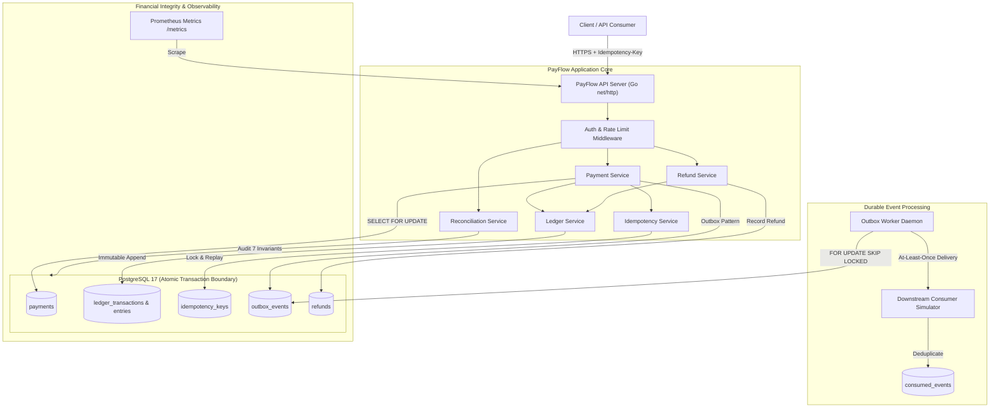
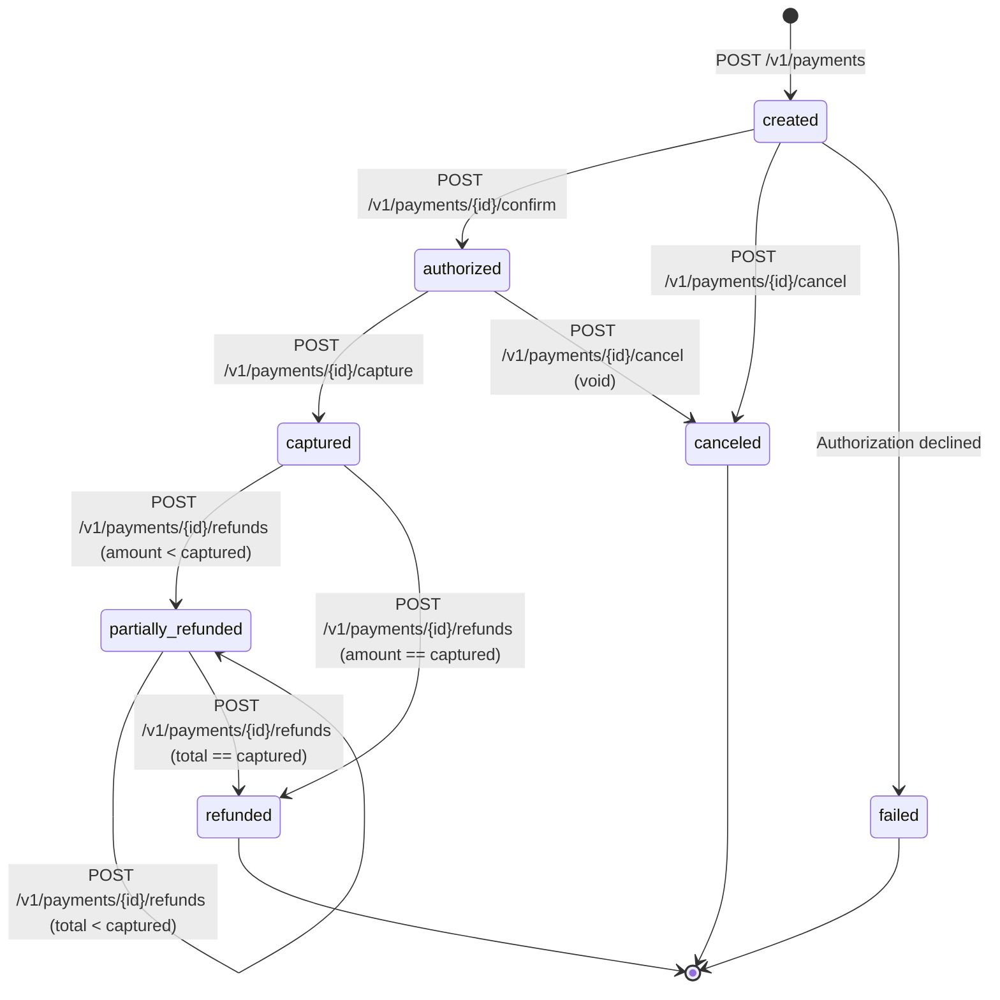

# PayFlow — Payment Processing & Double-Entry Ledger System

[](https://golang.org)
[](https://www.postgresql.org/)
[](LICENSE)
[](https://github.com/payflow/payflow/actions)

**PayFlow** is a simulated payment processing and double-entry ledger platform designed to demonstrate distributed systems correctness, ACID transaction boundaries, explicit concurrency controls, idempotent API operations, durable outbox event streaming, and automated financial reconciliation.

---

## Architecture Overview



---

## Key Invariants & Guarantees

1. **Integer Minor Units**: All monetary amounts are 64-bit signed integers (`int64` / `BIGINT`). Floating-point arithmetic is prohibited across the platform.
2. **Double-Entry Balance Equation**: Every posted ledger transaction balances independently per currency:
   $$\sum \text{Debits} = \sum \text{Credits}$$
3. **Immutable Ledger**: Database triggers (`trg_immutable_ledger_entries`, `trg_immutable_ledger_transactions`) abort any `UPDATE` or `DELETE` attempt on posted entries.
4. **Row-Level Concurrency Safety**: All mutations lock the payment row using `SELECT ... FOR UPDATE`, guaranteeing serial execution under race conditions.
5. **Idempotency with SHA-256 Fingerprinting**: Concurrent requests with the same key receive `409 Conflict`; completed requests return cached responses (`Idempotent-Replayed: true`); parameter mismatches return `422 Unprocessable Entity`.
6. **Transactional Outbox**: Business state changes and outbox events commit atomically in the same database transaction.
7. **Worker Lease Recovery**: The background worker claims events using `SKIP LOCKED` and reclaims expired leases (60s) after crashes.
8. **Independent Financial Reconciliation**: Detects 7 classes of anomalies without silent mutation.

---

## Payment Lifecycle State Machine



---

## Sequence Diagrams

### 1. Payment Capture & Double-Entry Ledger Posting

```mermaid
sequenceDiagram
    autonumber
    actor Client
    participant API as PayFlow API
    participant Idem as Idempotency Engine
    participant DB as PostgreSQL (Transaction)
    participant Outbox as Outbox Queue

    Client->>API: POST /v1/payments/{id}/capture (Idempotency-Key: k1)
    API->>DB: BEGIN TRANSACTION
    API->>Idem: LockOrGet(k1, request_hash)
    Idem->>DB: INSERT INTO idempotency_keys (status='started')
    API->>DB: SELECT * FROM payments WHERE id = $1 FOR UPDATE
    Note over API,DB: Row-level lock acquired; concurrent captures/refunds blocked
    API->>API: Validate state (must be 'authorized') and capture amount
    API->>DB: UPDATE payments SET status='captured', captured_amount=...
    API->>API: Calculate platform fee & merchant net
    API->>DB: INSERT INTO ledger_transactions (status='POSTED')
    API->>DB: INSERT INTO ledger_entries (Debit: Clearing, Credit: Merchant, Credit: Fee)
    Note over API,DB: Invariant Check: Total Debits == Total Credits
    API->>DB: INSERT INTO outbox_events (payment.captured, ledger.posted)
    API->>DB: UPDATE idempotency_keys SET status='completed', response_code=200
    API->>DB: COMMIT TRANSACTION
    API-->>Client: 200 OK (Payment Object)
```

### 2. Concurrent Competing Refunds

```mermaid
sequenceDiagram
    autonumber
    actor C1 as Client A (Refund $70)
    actor C2 as Client B (Refund $70)
    participant DB as PostgreSQL (Payments Table)

    Note over C1,C2: Payment captured for $100. Both clients issue $70 refund requests simultaneously.
    C1->>DB: BEGIN; SELECT * FROM payments FOR UPDATE
    C2->>DB: BEGIN; SELECT * FROM payments FOR UPDATE (BLOCKED by lock)
    Note over C1,DB: Client A acquires row lock
    C1->>C1: Check: 70 <= (100 - 0) -> Allowed
    C1->>DB: UPDATE payments SET refunded_amount=70, status='partially_refunded'
    C1->>DB: COMMIT
    Note over C2,DB: Client B unblocks and reads committed row
    C2->>C2: Check: 70 <= (100 - 70 = 30) -> FAILS!
    C2->>DB: ROLLBACK
    C2-->>C2: Returns 422 Unprocessable Entity (exceeds_refundable_amount)
```

---

## Measured Benchmark Performance

*Benchmarks executed on 12th Gen Intel(R) Core(TM) i5-1240P (16 threads), Go 1.26, PostgreSQL 17.*

| Benchmark | Throughput | Latency | Memory / Op |
|---|---|---|---|
| **Payment Creation** (Idempotency + Outbox) | **389 ops/sec** | 2.57 ms/op | 14.7 KB / 343 allocs |
| **Payment Lookup** (Primary Key index) | **1,956 ops/sec** | 0.51 ms/op | 3.1 KB / 77 allocs |
| **Idempotent Replay** (Cached response) | **1,572 ops/sec** | 0.64 ms/op | 3.6 KB / 70 allocs |
| **Ledger Posting** (Capture + 3 balanced entries) | **167 ops/sec** | 6.00 ms/op | 37.0 KB / 817 allocs |
| **Outbox Processing** (`SKIP LOCKED` batch) | **1,714 events/sec**| 0.58 ms/op | 3.3 KB / 74 allocs |
| **Concurrent Capture & Refund Workload** | **82 ops/sec** | 12.16 ms/op | 123.1 KB / 2,308 allocs |

---

## Quickstart & Local Setup

### Option 1: Docker Compose (Recommended)

From a clean checkout:

```bash
docker compose up --build -d
```

Services started:
- `payflow-api`: `http://localhost:8080`
- `payflow-worker`: Outbox daemon
- `payflow-postgres`: PostgreSQL 17 on `localhost:5432`
- `payflow-prometheus`: Prometheus metrics UI on `http://localhost:9090`

### Option 2: Running Locally with Go

1. Start PostgreSQL (or have PostgreSQL 17 running locally):
   ```bash
   cp .env.example .env
   ```
2. Build and run the server:
   ```bash
   go run ./cmd/api
   ```
   *Note: Database migrations run automatically on startup via embedded SQL migrations.*

---

## API Guide & Example Curl Commands

### 1. Onboard Merchant
```bash
curl -s -X POST http://localhost:8080/v1/merchants \
  -H "Content-Type: application/json" \
  -d '{"name": "Acme Coffee"}'
```
*Returns merchant `id` and raw one-time API key `sk_test_...`.*

### 2. Create Customer
```bash
curl -s -X POST http://localhost:8080/v1/customers \
  -H "Authorization: Bearer sk_test_..." \
  -H "Content-Type: application/json" \
  -d '{"email": "customer@example.com", "name": "Jane Cardholder"}'
```

### 3. Create Payment Intent ($100.00 = 10,000 cents)
```bash
curl -s -X POST http://localhost:8080/v1/payments \
  -H "Authorization: Bearer sk_test_..." \
  -H "Idempotency-Key: idem-pay-001" \
  -H "Content-Type: application/json" \
  -d '{
    "customer_id": "<CUSTOMER_ID>",
    "amount": 10000,
    "currency": "USD",
    "description": "Premium Roast Subscription"
  }'
```

### 4. Authorize and Capture Payment
```bash
# Confirm / Authorize
curl -s -X POST http://localhost:8080/v1/payments/<PAYMENT_ID>/confirm \
  -H "Authorization: Bearer sk_test_..."

# Capture
curl -s -X POST http://localhost:8080/v1/payments/<PAYMENT_ID>/capture \
  -H "Authorization: Bearer sk_test_..."
```

### 5. Issue Partial and Full Refunds
```bash
# Partial refund of $40.00
curl -s -X POST http://localhost:8080/v1/payments/<PAYMENT_ID>/refunds \
  -H "Authorization: Bearer sk_test_..." \
  -H "Content-Type: application/json" \
  -d '{"amount": 4000, "reason": "Customer returned partial order"}'

# Second refund of $60.00 (transitions payment to 'refunded')
curl -s -X POST http://localhost:8080/v1/payments/<PAYMENT_ID>/refunds \
  -H "Authorization: Bearer sk_test_..." \
  -H "Content-Type: application/json" \
  -d '{"amount": 6000, "reason": "Remainder refund"}'
```

### 6. Inspect Double-Entry Ledger
```bash
# List ledger accounts
curl -s http://localhost:8080/v1/ledger/accounts \
  -H "Authorization: Bearer sk_test_..."

# List entries
curl -s http://localhost:8080/v1/ledger/entries \
  -H "Authorization: Bearer sk_test_..."
```

### 7. Trigger Independent Reconciliation Audit
```bash
curl -s -X POST http://localhost:8080/internal/reconciliation/runs
```

---

## Automated Verification & Test Commands

```bash
# Run unit tests
go test -v ./internal/domain/... ./internal/api/...

# Run PostgreSQL integration & concurrency tests
go test -v ./internal/repository/postgres/...

# Run race detection
go test -race -v ./internal/domain/... ./internal/api/...

# Run benchmarks
cd internal/repository/postgres && go test -bench=Benchmark -benchmem -benchtime=50x
```

---

## Project Structure

```
payflow/
├── cmd/
│   ├── api/main.go                 # HTTP server entrypoint & graceful shutdown
│   └── worker/main.go              # Standalone outbox worker entrypoint
├── internal/
│   ├── domain/                     # Pure business logic, state machines, errors
│   ├── repository/                 # Data access interfaces & PostgreSQL impl
│   │   └── postgres/               # Row locking, explicit transactions
│   ├── service/                    # Application services (Payment, Refund, Ledger, Outbox)
│   ├── api/                        # HTTP routing, authentication, middleware
│   ├── config/                     # Environment configuration & validation
│   ├── database/                   # Connection pool & embedded migration runner
│   ├── metrics/                    # Prometheus metrics registry
│   └── testutil/                   # Real PostgreSQL test harness
├── migrations/                     # Raw SQL database migrations (up/down)
├── api/openapi.yaml                # OpenAPI 3.1 formal API specification
├── docs/
│   ├── invariants.md               # State machine & double-entry equations
│   ├── failure_modes.md            # Distributed fault analysis
│   ├── benchmarks.md               # Measured performance report
│   └── tradeoffs.md                # Engineering trade-offs
├── scripts/
│   ├── demo.sh                     # Bash end-to-end verification script
│   └── demo.ps1                    # PowerShell end-to-end verification script
├── Dockerfile                      # Multi-stage static binary build
├── docker-compose.yml              # PostgreSQL, API, Worker, Prometheus
├── Makefile                        # Build, test, and run shortcuts
└── README.md                       # Documentation & Architecture
```

---

## License
MIT License. Created for technical demonstration purposes.
