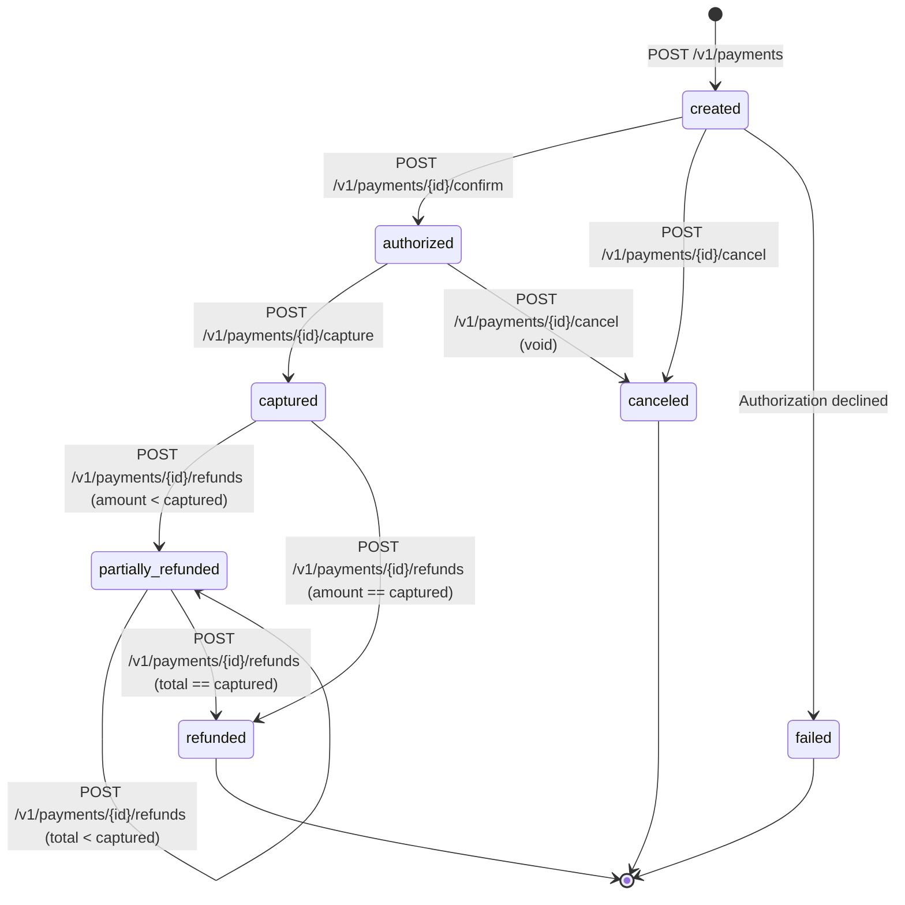

# PayFlow System Invariants & Formal Guarantees

This document details the core invariants and concurrency guarantees enforced by the **PayFlow** payment processing and double-entry ledger platform.

---

## 1. Monetary Amount & Currency Invariants

1. **Integer Minor Units**: Floating-point representations (`float32`, `float64`) are strictly forbidden across domain logic, database columns, and API schemas. All amounts represent the smallest currency unit (cents for USD/EUR, pence for GBP) as 64-bit signed integers (`int64` / PostgreSQL `BIGINT`).
2. **Positive Monotonic Amounts**: Every creation, capture, and refund amount must be strictly greater than zero (`amount > 0`).
3. **Upper Safety Bound**: Amounts cannot exceed `MaxMinorUnitAmount` ($10,000,000 in minor units = 1,000,000,000 cents) to prevent arithmetic integer overflow.
4. **Currency Whitelist**: Currencies are constrained to validated ISO-4217 three-letter codes (`USD`, `EUR`, `GBP`). Cross-currency transactions within a single ledger transaction are rejected.

---

## 2. Payment State Machine Invariants

### Invariant Rules:
1. **No Capture Without Authorization**: A payment cannot be captured unless its current state is `authorized`. Attempting to capture a `created`, `canceled`, or `failed` payment returns `422 Unprocessable Entity` (`invalid_state_transition`).
2. **No Capture After Cancellation**: Once a payment transitions to `canceled`, it is in a terminal state and can never be captured or authorized.
3. **Partial Capture Limits**: If a capture request specifies a custom amount, it must satisfy `0 < capture_amount <= payment.amount`.
4. **No Refund Without Capture**: A payment cannot be refunded unless it is in `captured` or `partially_refunded` status. Attempting to refund an `authorized` or `created` payment is rejected.
5. **Cumulative Refund Ceiling**:
   $$\text{refund\_amount} \le \text{captured\_amount} - \text{refunded\_amount}$$
   Any refund request exceeding available captured funds is rejected with `422 Unprocessable Entity` (`exceeds_refundable_amount`).
6. **Terminal Refund Transition**: When `refunded_amount == captured_amount`, the payment transitions irrevocably to `refunded`.

---

## 3. Double-Entry Accounting Invariants

The fundamental accounting equation governs every posted transaction:

$$\sum \text{Debits} = \sum \text{Credits} \quad (\text{per currency})$$

1. **Zero Sum Balance**: Every posted `LedgerTransaction` must consist of at least two `LedgerEntry` records whose total debit minor units exactly equal total credit minor units.
2. **Immutability Trigger**: Ledger entries and transactions can never be modified (`UPDATE`) or deleted (`DELETE`). This invariant is enforced by PostgreSQL row-level database triggers (`trg_immutable_ledger_entries` and `trg_immutable_ledger_transactions`).
3. **Corrective Postings Only**: All reversals, adjustments, and refunds must be represented through distinct compensating ledger transactions.
4. **Single Posting per Business Reference**: A unique database constraint on `(business_reference_type, business_reference_id)` prevents accidental or concurrent duplicate postings for the same capture or refund.

### Chart of Accounts & Flow of Funds

| Account Name | Type | Scope | Balance Sign Meaning |
|---|---|---|---|
| `customer_funds_clearing` | `asset` | System per currency | Debit increases funds receivable/in-transit from clearing networks |
| `platform_fee_revenue` | `revenue` | System per currency | Credit increases platform fee revenue earned by PayFlow |
| `merchant_payable` | `liability` | Merchant per currency | Credit increases funds held by PayFlow owed to merchant |

#### Capture Example ($100.00, fee $3.20):
- **DEBIT** `customer_funds_clearing`: 10,000 cents
- **CREDIT** `merchant_payable_{merchant}`: 9,680 cents
- **CREDIT** `platform_fee_revenue`: 320 cents
- Total Debits = 10,000; Total Credits = 10,000. Balanced.

#### Refund Example ($40.00):
- **DEBIT** `merchant_payable_{merchant}`: 4,000 cents
- **CREDIT** `customer_funds_clearing`: 4,000 cents
- Total Debits = 4,000; Total Credits = 4,000. Balanced.

---

## 4. Concurrency & Isolation Guarantees

1. **Row-Level Serialization**:
   All state transitions, captures, and refunds acquire exclusive row locks using `SELECT ... FROM payments WHERE id = $1 FOR UPDATE`.
   - Parallel captures: The first transaction captures the payment; the second transaction unblocks, detects `status = 'captured'`, and safely fails with `422 payment_already_captured`.
   - Parallel refunds: Two simultaneous $70 refunds on a $100 payment are serialized. The first completes, updating `refunded_amount = 70`. The second unblocks, observes `available = 30`, and fails cleanly with `422 exceeds_refundable_amount`.
2. **Atomic Invariant Boundary**:
   Payment state changes, outbox events, ledger transactions, and idempotency updates are committed inside a single database transaction. If ledger validation or outbox persistence fails, the entire transaction rolls back, leaving no orphan records.

---

## 5. Idempotency Guarantees

1. **Fingerprint Match**: Idempotency records track `(merchant_id, key)` with a SHA-256 hash of the canonicalized JSON body, method, and URI path.
2. **Concurrent Request Lock**:
   - If an idempotency record exists with `status = 'started'` from another active request, subsequent concurrent callers receive `409 Conflict` with `Retry-After: 1`.
   - If the request is completed, the cached response code and body are returned with header `Idempotent-Replayed: true`.
   - If the same key is reused with different request parameters, the request is rejected with `422 Unprocessable Entity` (`idempotency_key_mismatch`).
